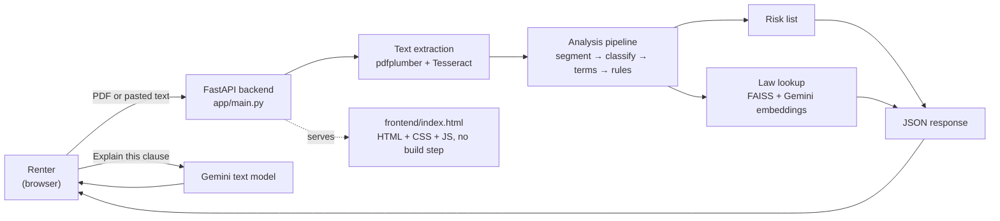
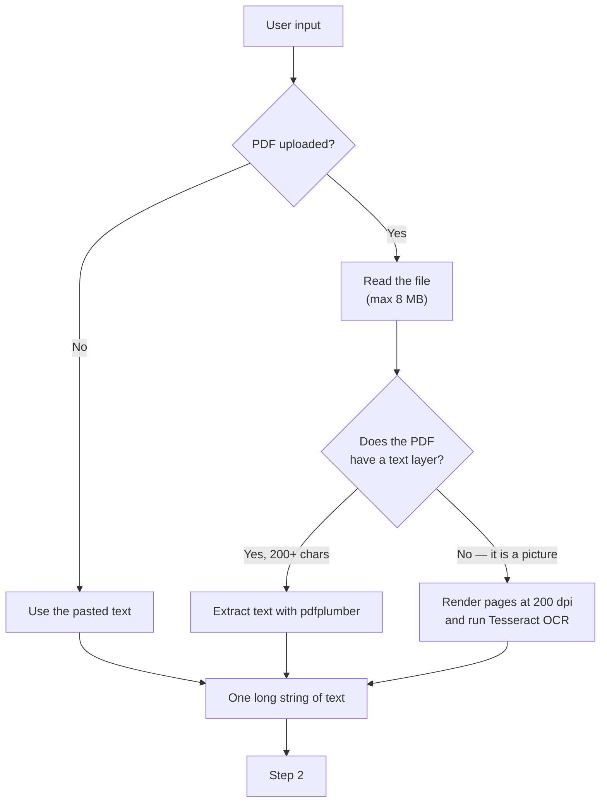
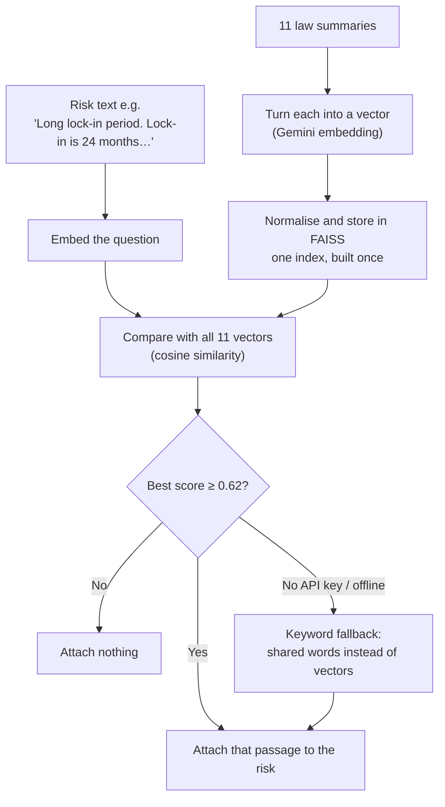
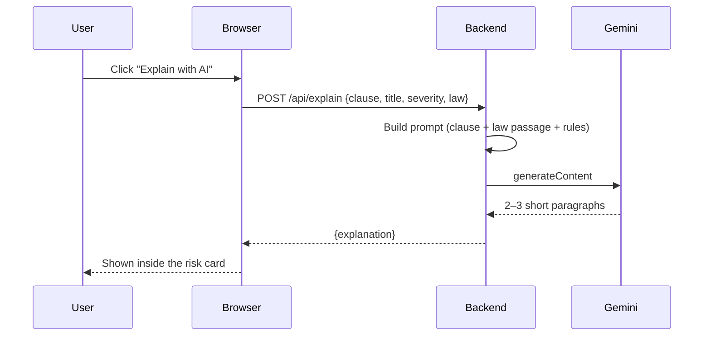
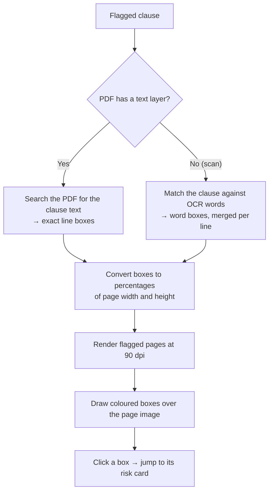
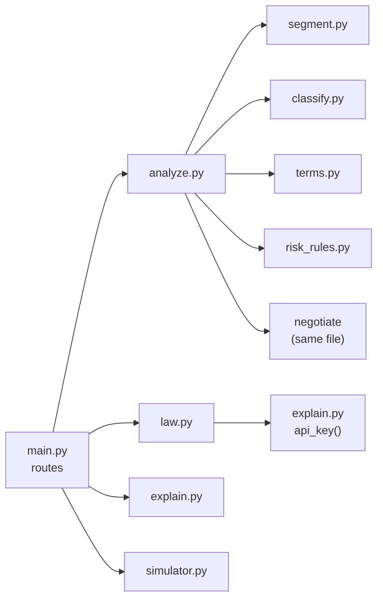

# Clause Compass — Project Guide

A complete, plain-English explanation of what this app does, how it works, and why it is built the way it is.

Written so that someone who has never seen the code — or the project — can understand the whole thing end to end.

---

## Contents

1. [What this project is](#1-what-this-project-is)
2. [Who it is for and the journey](#2-who-it-is-for-and-the-journey)
3. [The big picture](#3-the-big-picture)
4. [The ten steps, one by one](#4-the-ten-steps-one-by-one)
5. [How the nine risk rules work](#5-how-the-nine-risk-rules-work)
6. [How the law lookup works (RAG)](#6-how-the-law-lookup-works-rag)
7. [How the AI explanation works](#7-how-the-ai-explanation-works)
8. [How the leave-early simulator works](#8-how-the-leave-early-simulator-works)
9. [How highlights are drawn on a PDF](#9-how-highlights-are-drawn-on-a-pdf)
10. [The API in full](#10-the-api-in-full)
11. [The files and what each one does](#11-the-files-and-what-each-one-does)
12. [The screen, section by section](#12-the-screen-section-by-section)
13. [Running and testing it](#13-running-and-testing-it)
14. [Design decisions and their reasons](#14-design-decisions-and-their-reasons)
15. [Known limits (honest list)](#15-known-limits-honest-list)
16. [Glossary](#16-glossary)
17. [Mini FAQ](#17-mini-faq)

---

## 1. What this project is

**Clause Compass reads a rental agreement and points out the parts that can cost you money.**

You give it a lease — as a PDF or as pasted text. In a few seconds it tells you:

- which clauses are risky, and how risky (high / medium / low),
- *why* each one is risky, in plain English,
- what to ask the landlord to change,
- a short passage of tenancy law that is relevant to that clause,
- what it would cost you to leave the agreement early,
- a ready-to-send message to the landlord asking for those changes.

It is **informational only. It is not legal advice.** That sentence appears on every screen and in every report.

What it is **not**:

- It is not a lawyer and does not read the whole law.
- It does not "understand" the agreement the way a person does. It uses **rules** for the risks and an **AI model** only for explanations.
- It does not prove a clause is illegal. It says: *this is the kind of clause that usually deserves a conversation.*

---

## 2. Who it is for and the journey

**User:** a renter who has been handed a draft agreement and does not know which lines to worry about.

The entire journey takes about one minute:

| Step | What the user does | What happens |
|---|---|---|
| 1 | Opens the page | Sees a paste box and an upload button |
| 2 | Pastes the agreement text, or uploads a PDF | The text is read (OCR if the PDF is a scan) |
| 3 | Presses **Analyze agreement** | The app segments, classifies, flags risks, looks up law |
| 4 | Reads the results | Risk cards on the right, clause text on the left |
| 5 | Clicks **Clause 3 →** on a risk card | Jumps to that clause, which pulses green |
| 6 | Clicks **✦ Explain with AI** on a card | Gemini explains that single clause in plain English |
| 7 | Drags **Months stayed** under "If I leave early" | Sees the real cost of leaving at that point |
| 8 | Presses **Draft message** | Gets a polite negotiation message |
| 9 | Presses **Download report (PDF)** | Browser print dialog with a clean layout |

Nothing is saved. There is no login, no database, no history. Close the tab and the agreement is gone.

---

## 3. The big picture

The app is two halves: a **Python backend** that does all the thinking, and **one HTML page** that shows the result. The browser asks; the backend answers with JSON.



The same picture without the diagram, in words:

```
Browser  →  POST /api/analyze  →  Backend
                                   ├─ read the PDF (or take the text)
                                   ├─ OCR if the PDF is only pictures
                                   ├─ split into clauses
                                   ├─ label each clause by kind
                                   ├─ pull out numbers (rent, deposit, lock-in…)
                                   ├─ run 9 rules over the clauses
                                   ├─ find a law passage for each risk
                                   └─ return JSON
Browser  ←  JSON  ←  render cards, chart, highlights
```

**Key structural fact:** the backend is **stateless**. Every request carries everything needed. The only shared state is a cache of the law index, built once at start-up.

---

## 4. The ten steps, one by one

### Step 1 — Input arrives

Two ways in, one endpoint:



Why it matters: a PDF made by Word has real letters inside, so they can be copied out in milliseconds. A scanned or photographed PDF has only pixels — the software must *look* at the picture and guess the letters. That is OCR, and it can be wrong.

### Step 2 — Split into clauses (`segment.py`)

The text is cut at lines that look like clause headings:

```
1. Rent. The monthly rent shall be Rs. 20,000 …
2. Security Deposit. The Tenant shall pay …
```

The rule: a line starting with a number, a dot or bracket, and then a word, begins a new clause. Lines that do not start that way are treated as continuations and glued to the clause above. If fewer than three numbered clauses are found, it falls back to splitting on blank lines (paragraphs).

Result: a list like `[{id: "c1", text: "…"}, {id: "c2", text: "…"}]`.

### Step 3 — Label each clause (`classify.py`)

Every clause gets one label, from a fixed list of 11:

`lock_in`, `security_deposit`, `rent_escalation`, `landlord_entry`, `termination`, `repairs`, `subletting`, `notice_period`, `rent`, `utilities`, `other`.

The classifier counts how many of a label's keywords appear in the clause and picks the highest count. Ties keep the list's priority order.

Why counts and not "first match": a termination clause that also mentions "deposit" would otherwise be labelled a deposit clause, and the deposit rules would fire on it twice. Counting fixes that.

### Step 4 — Pull out the numbers (`terms.py`)

Nine values are extracted, because the rules and the calculator need them:

| Field | Meaning | Example found in text |
|---|---|---|
| `rent` | Monthly rent | "monthly rent shall be Rs. 20,000" |
| `deposit` | Deposit amount | "deposit of Rs. 1,20,000" |
| `deposit_months` | Deposit as months of rent | "6 months of rent", "ten months rent" |
| `lockin_months` | Lock-in length | "lock-in period of 24 months", "may not terminate before 11 months" |
| `notice_days` | Notice period | "2 months notice" → 60 days |
| `escalation_pct` | Rent increase cap | "increase by 5%" |
| `penalty_months` | Exit penalty | "penalty of two months rent" |
| `penalty_remaining` | Must pay remaining lock-in rent | "remaining rent for the lock-in period" |
| `fixed_deductions` | Flat deductions | user-entered |

Numbers written as words ("ten", "two") are converted to digits first, so prose agreements work.

If a value cannot be found, it stays `null` and the user gets a warning: *"Could not find 'rent'. Please fill it in."* Every field is editable on the results screen.

### Step 5 — Run the risk rules (`risk_rules.py`)

Nine small functions, each answering one question. They only read the clauses and the extracted numbers — no AI. Details in [section 5](#5-how-the-nine-risk-rules-work).

Each risk becomes one object:

```json
{
  "rule_id": "entry_no_notice",
  "clause_id": "c7",
  "severity": "high",
  "title": "Landlord entry without notice",
  "reason": "The landlord may enter without advance notice.",
  "ask": "Ask for at least 24 hours' notice, except in emergencies, at reasonable hours."
}
```

Risks are sorted high → medium → low.

### Step 6 — Find a matching law passage (`law.py`)

For each risk, the app searches a small library of 11 short tenancy-law summaries and attaches the closest one. This is the "RAG" part; explained fully in [section 6](#6-how-the-law-lookup-works-rag).

### Step 7 — Prepare highlights (`pdf.py → pdf_marks`)

If a PDF was uploaded, the app works out **where on the page** each flagged clause appears, so the screen can draw coloured boxes over the page image. Explained in [section 9](#9-how-highlights-are-drawn-on-a-pdf).

### Step 8 — Return one JSON response

Everything is bundled together:

```json
{
  "clauses": [ … ],
  "terms": { … },
  "warnings": [ … ],
  "risks": [ … ],
  "summary": { "high": 4, "medium": 5, "low": 0, "text": "4 high, 5 medium, 0 low" },
  "disclaimer": "Informational only, not legal advice.",
  "ocr": false,
  "text": "",
  "pdf": { "pages": [ … ], "marks": [ … ], "truncated": false }
}
```

### Step 9 — The browser draws the screen

The single page renders four things: the clause list (coloured by severity), the risk cards, the editable numbers, and the PDF pages with boxes. No framework, no build step — about 400 lines of HTML, CSS and JavaScript.

### Step 10 — Optional extras

- **Explain with AI** — one extra request, one clause, one answer.
- **Leave-early calculator** — one extra request each time the slider moves.
- **Negotiation message** — built from the top three risks.
- **Print report** — the browser's own print function plus a print stylesheet.

---

## 5. How the nine risk rules work

Each rule is a function that returns a risk or nothing. All are deterministic: the same agreement always gives the same result. That is deliberate — a rule-based core can be tested and explained, unlike a black box.

| # | Rule id | Fires when | Severity | What it means for the renter |
|---|---|---|---|---|
| 1 | `long_lockin` | Lock-in is longer than 11 months | high if ≥ 24, else medium | You cannot leave for that long, or you pay |
| 2 | `exit_penalty` | Clause says penalty / forfeiture / remaining rent on early exit, with no matching landlord duty | high if "remaining rent", else medium | Leaving early is one-sided and expensive |
| 3 | `high_deposit` | Deposit is more than 3 months of rent | high if > 6, else medium | Too much of your money is locked with the landlord |
| 4 | `vague_deductions` | "deemed fit", "sole discretion", "any and all" in a deposit clause | medium | The landlord can keep part of the deposit without proof |
| 5 | `no_refund_deadline` | A deposit clause with no number of days for refund | medium | You may wait forever for your money |
| 6 | `unlimited_escalation` | A rent-increase clause with no percentage | medium | Rent can rise by any amount |
| 7 | `entry_no_notice` | "any time", "without notice", or no mention of notice | high if "any time", else medium | Your home is not fully private |
| 8 | `immediate_eviction` | Landlord may end the tenancy "immediately" / "without notice" | high | You could be evicted with no warning and no chance to fix it |
| 9 | `tenant_pays_all_repairs` | "all repairs" on the tenant, with no structural / major split | medium | You pay for the building's problems |

**Important design choice:** rules look for *wording patterns linked to a clause type*, not for legal truth. So a rule can miss a risk phrased unusually, and can occasionally fire on a harmless clause. This is why every risk card also says **"Ask for"** — the output is a prompt for a conversation, not a verdict.

The count of nine is not special. Adding a rule is one function with the `@rule` decorator; nothing else changes.

---

## 6. How the law lookup works (RAG)

**RAG** = *Retrieval-Augmented Generation*. In plain words: **look something up first, then let the AI talk about it.** Without the lookup, an AI is happy to invent a law. With it, the AI is handed a real passage and told to stay inside it.

### The library

`backend/data/law/tenancy.json` holds 11 short, curated summaries — *not* verbatim statute:

```
deposit-cap              cap on the security deposit
deposit-refund           refund after deducting damage
agreement-in-writing     written and registered agreements
lock-in                  lock-ins are contractual, not statutory
exit-penalty             penalties must be reasonable
rent-increase            rent rises only as agreed
landlord-entry           notice before entry
repairs                  structural repairs are the landlord's duty
eviction                 eviction needs a ground and due process
notice-to-quit           notice periods should be equal
subletting               subletting needs written consent
```

### The search



A **vector** is just a list of numbers that represents meaning. Two pieces of text about the same idea get similar numbers. **Cosine similarity** measures how close two vectors point in the same direction — 1.0 is identical, 0 is unrelated.

Why a threshold: `MIN_SCORE = 0.62`. Below it, the match is probably wrong, and a wrong law passage is worse than none.

Why a keyword fallback: the app must still work with no internet or no API key. The fallback scores each summary by shared words (ignoring common words like "the", "and", "shall").

The index is cached in memory and rebuilt only when the server restarts. That means **editing `tenancy.json` requires a restart**.

---

## 7. How the AI explanation works

The **✦ Explain with AI** button is the only place a large language model writes anything the user reads. Everything else is rules and arithmetic.



The prompt has strict instructions:

- explain the clause to a renter in plain English,
- at most three short paragraphs, no headings or lists,
- say what each side may do, why it matters, and end with **one practical question to ask the landlord**,
- use the given law passage only if it genuinely applies,
- cite only the Act name and the reference text **exactly as given** — never invent a section number,
- never give legal advice.

Model settings: temperature 0.3 (fairly literal), maximum 500 output tokens, thinking disabled for speed.

**Honest limitation:** the model can still be wrong, or attach a real Act name to a summary that is not the statute's wording. That is why every explanation ends with *"AI-generated. Verify with the clause text."*

If no API key is configured, the button returns a clear 503 instead of failing silently.

---

## 8. How the leave-early simulator works

Pure arithmetic, no AI. Inputs come from the editable fields; the output is what leaving at month *M* would cost.

Let:

- `rent` = monthly rent,
- `deposit` = security deposit,
- `lockin` = lock-in months,
- `notice` = notice period in days,
- `stayed` = months stayed so far,
- `penalty_months` = exit penalty in months of rent,
- `penalty_remaining` = must also pay the remaining lock-in rent,
- `deductions` = flat deductions.

Then:

```
remaining      = max(0, lockin − stayed)
notice_rent    = rent × notice ÷ 30
remaining_rent = rent × remaining          (only if penalty_remaining)
rent_owed      = max(notice_rent, remaining_rent)

penalty        = rent × penalty_months      (only while still inside the lock-in)
total_cost     = rent_owed + penalty + deductions

deposit_refund = max(0, deposit − total_cost)
out_of_pocket  = max(0, total_cost − deposit)
```

Read it as: *you owe whichever is bigger — the notice-period rent or the rest of the lock-in — plus any penalty, plus fixed deductions. The deposit pays for it first; anything beyond the deposit comes out of your pocket.*

The chart shows the same calculation for every month from 0 to just past the lock-in, so you can see the cost fall to zero at the right moment.

**Assumption to know:** the penalty is treated as applying **only inside the lock-in**. If a contract charges a penalty after the lock-in ends, the calculator shows 0 for that month. This is listed in the limitations.

---

## 9. How highlights are drawn on a PDF

There are two completely different paths, depending on whether the PDF contains real text.



Why percentages: the page image can be any size on any screen; storing `{left: 26.3%, top: 17.4%, width: 64%, height: 1.2%}` means the box always lines up.

Severity colours match the rest of the app: red-orange for high, amber for medium, olive for low.

**Scans:** the OCR engine returns a box and a confidence score for every word. Words below confidence **60** are thrown away before matching, so a clause containing an uncertain word gets **no box** instead of a wrong one. Matched words on the same line are merged into one strip.

**Limits:** only the first 8 pages that contain a flag are rendered; at most 40 boxes per clause. A skewed phone photo will make boxes drift; a clean scan lines up within about half a percent of where the digital path puts them.

---

## 10. The API in full

All endpoints are JSON except the upload, which is a form.

| Method | Path | Purpose |
|---|---|---|
| GET | `/` | The single-page app |
| GET | `/api/health` | `{"ok": true}` — liveness check |
| GET | `/api/sample` | The built-in sample agreement text |
| POST | `/api/analyze` | Analyse text or a PDF (form field `text`, or file `file`) |
| POST | `/api/simulate` | Leave-early numbers + chart series |
| POST | `/api/negotiate` | Draft message from the risk list |
| POST | `/api/explain` | AI explanation for one clause |

### POST /api/analyze

Send **either** `text` (form field) **or** `file` (PDF, ≤ 8 MB, ≤ 30 pages).

Returns `clauses`, `terms`, `warnings`, `risks`, `summary`, `disclaimer`, `ocr`, `text`, `pdf`.

- `ocr: true` means the PDF had no text layer, and `text` contains the OCR result for the user to correct.
- `pdf.pages` are base64 PNG data URIs; `pdf.marks` are the boxes; `pdf.truncated` says the 8-page cap was hit.

### POST /api/simulate

```json
{ "rent": 25000, "deposit": 250000, "lockin_months": 11, "notice_days": 0,
  "months_stayed": 5, "penalty_months": 2 }
```

Returns `result` (the numbers above), `series` (one point per month), `assumptions`, `disclaimer`.

### POST /api/negotiate

```json
{ "risks": [ …the risks array from analyze… ] }
```

Returns `{ "message": "Hi, …" }` built from the three most severe risks.

### POST /api/explain

```json
{ "text": "The Landlord may enter at any time…", "title": "Landlord entry without notice",
  "severity": "high", "law": { "act": "…", "ref": "…", "text": "…" } }
```

Returns `{ "explanation": "…" }`. Text shorter than 15 characters is rejected with 400.

### Error codes you can hit

| Code | When |
|---|---|
| 400 | No text, text too short, unreadable PDF |
| 413 | File over 8 MB, or more than 30 pages |
| 415 | Uploaded file is not a `.pdf` |
| 422 | OCR could not read the scan |
| 502 / 503 | Gemini failed / no API key |

---

## 11. The files and what each one does

```
clause-compass/
├── README.md                  short setup notes
├── DOCUMENTATION.md           this document
├── samples/                   test PDFs + what each one proves
│   ├── risky-agreement.pdf
│   ├── fair-agreement.pdf
│   ├── risky-agreement-scanned.pdf
│   └── README.md
├── frontend/
│   └── index.html             the whole UI: HTML + CSS + JS, no build
└── backend/
    ├── requirements.txt
    ├── pytest.ini
    ├── .env                   GEMINI_API_KEY (git-ignored)
    ├── data/
    │   ├── sample_agreement.txt
    │   └── law/tenancy.json   11 curated law summaries
    ├── tests/test_core.py     15 tests
    └── app/
        ├── main.py            FastAPI app + routes
        ├── pdf.py             PDF text, OCR fallback, clause highlights
        ├── analyze.py         runs the pipeline; negotiation message
        ├── segment.py         text → clauses
        ├── classify.py        clause → label
        ├── terms.py           clause → numbers
        ├── risk_rules.py      the 9 rules + summary
        ├── law.py             FAISS retrieval + keyword fallback
        ├── explain.py         prompt building + Gemini call
        ├── simulator.py       leave-early arithmetic
        └── redact.py          strips emails / phones / PANs (not yet wired in)
```

### What calls what



---

## 12. The screen, section by section

One page, two modes: **home** and **results**.

### Home

```
┌──────────────────────────────────────────────────────────────┐
│  ◉ Clause Compass                                            │
├──────────────────────────────────────────────────────────────┤
│  RENTAL AGREEMENT CHECK                                      │
│  Know what you're signing.                                   │
│  Paste or upload a lease. …                                  │
│                                                              │
│  ┌────────────────────────────────────────────────────────┐  │
│  │ Agreement text                        0 characters     │  │
│  │ ┌────────────────────────────────────────────────────┐ │  │
│  │ │ Paste the agreement text here…                     │ │  │
│  │ └────────────────────────────────────────────────────┘ │  │
│  │ [Analyze agreement]      [Try a sample] [Upload PDF]   │  │
│  │ PDF up to 8 MB and 30 pages. Never stored.             │  │
│  └────────────────────────────────────────────────────────┘  │
│                                                              │
│  ┌ Clause flags ┐  ┌ Leave-early cost ┐  ┌ AI explanations ┐ │
│  └──────────────┘  └──────────────────┘  └─────────────────┘ │
└──────────────────────────────────────────────────────────────┘
```

### Results

```
┌──────────────────────────────────────────────────────────────┐
│  ◉ Clause Compass                    [4 high, 5 medium]      │
├──────────────────────────────────────────────────────────────┤
│  ┌ Summary: counts + Download report (PDF) ────────────────┐ │
│  └─────────────────────────────────────────────────────────┘ │
│                                                              │
│  LEFT COLUMN                    RIGHT COLUMN                 │
│  ┌ Agreement ─────────────┐    ┌ Flagged risks ───────────┐  │
│  │ 1. Rent …              │    │ HIGH          Clause 3 → │  │
│  │ 2. Deposit (medium)    │    │ Long lock-in period      │  │
│  │ 3. Lock-in (high)      │    │ … Ask for …              │  │
│  │ …                      │    │ ┌ Legal basis ─────────┐ │  │
│  └────────────────────────┘    │ │ (law summary)        │ │  │
│  ┌ Key terms ─────────────┐    │ └──────────────────────┘ │  │
│  │ rent / deposit / …     │    │ [✦ Explain with AI]      │  │
│  └────────────────────────┘    └──────────────────────────┘  │
│  ┌ If I leave early ──────┐                                  │
│  │ slider + six stats     │                                  │
│  │ bar chart by month     │                                  │
│  └────────────────────────┘                                  │
│  ┌ Highlights on PDF ────┐                                   │
│  │ page image + boxes     │                                   │
│  └────────────────────────┘                                  │
│  ┌ Message to landlord ──┐                                   │
│  │ [Draft message] [Copy] │                                   │
│  └────────────────────────┘                                  │
└──────────────────────────────────────────────────────────────┘
```

Behaviour worth knowing:

- On a phone the columns collapse to one, and **risks come first** so the important thing is at the top.
- Clicking a clause jumps to its risk; clicking a risk's "Clause N →" jumps back. The target pulses green.
- Every number in **Key terms** is editable; changing one re-runs the calculator.
- Dark mode follows the operating system automatically.
- Printing hides the buttons and the background, and lays the report out as a clean document.

---

## 13. Running and testing it

```powershell
cd backend
python -m venv .venv
.venv\Scripts\activate
pip install -r requirements.txt
python -m pytest
uvicorn app.main:app --reload
```

Open <http://127.0.0.1:8000>.

**AI features need a key.** Put `GEMINI_API_KEY=…` in `backend/.env`. Without it, everything except "Explain with AI" still works: the law lookup falls back to keywords.

**OCR needs Tesseract** (only for scanned PDFs):

```powershell
winget install UB-Mannheim.TesseractOCR
```

The app looks for `C:\Program Files\Tesseract-OCR\tesseract.exe`; set `TESSERACT_CMD` to use another path.

### The sample files

| File | What it proves |
|---|---|
| `samples/risky-agreement.pdf` | 9 risks, 6 highlighted boxes, terms prefilled |
| `samples/fair-agreement.pdf` | No risks — no false alarms |
| `samples/risky-agreement-scanned.pdf` | OCR path: same risks, boxes from OCR word positions |

### The tests

15 tests, all offline (embeddings are stubbed so no network is used):

- segmentation (numbered and paragraph fallback),
- the sample agreement flags all nine expected rules, with the right extracted numbers,
- the fair agreement flags nothing,
- redaction strips names, emails, phones, PANs,
- the simulator matches hand-calculated cases,
- the API routes answer correctly, including the OCR path,
- the explanation prompt and route,
- PDF marks land on the right page, and are empty when nothing is flagged,
- scanned PDFs get OCR-positioned boxes inside the page bounds.

---

## 14. Design decisions and their reasons

**Rules for risks, AI only for explanation.**
A rule can be tested, audited and explained to a user. An AI cannot promise the same answer twice. So the *decision* is deterministic and the *wording* is AI.

**No database.**
Nothing needs to be remembered between requests. No account, no history, no data to leak or back up. It also means the whole app is a folder you can copy.

**One HTML file, no build step.**
No Node, no bundler, no framework. Open the file, it runs. For an interface this size, React would add more setup than code.

**Retrieve law, then generate.**
Handing the model a real passage and forbidding invention is the only reliable way to stop a legal-sounding hallucination.

**Percentages for highlight boxes.**
Page images render at different sizes; percentages survive every screen and every zoom level.

**Confidence gate on OCR.**
A missing highlight is a small annoyance. A highlight pointing at the wrong words looks like proof, and is much worse.

**Everything editable on the results screen.**
Extraction is regex over messy human text, so it will sometimes miss. Letting the user correct a number is cheaper and more honest than pretending the parser is perfect.

---

## 15. Known limits (honest list)

These are real, measured, and worth knowing before showing the app to others.

**Privacy**
- "Explain with AI" sends the clause text to Google. `redact.py` exists and is tested but **is not wired in yet**, so emails, phone numbers and PANs inside a clause are sent as-is.
- Nothing is stored by this app, but the AI provider receives the text it is asked about.

**Load and speed**
- Scanned PDFs take roughly 10–20 seconds; digital PDFs about 2–3 seconds.
- The analyze route is `async` but runs blocking OCR, so **one scan upload blocks every other request** until it finishes (measured: a health check took 2.85 s instead of milliseconds). Fine for one local user; a problem for two.
- No rate limiting and no auth. Do not expose this publicly with a paid API key attached.

**Accuracy**
- Rules match wording, not law. They can miss unusual phrasing and occasionally fire on a harmless clause.
- `< 200` characters of extracted text is treated as "a scan" and sent to OCR even if it was a short digital PDF.
- Rent is only recognised from a few phrases ("monthly rent", "rent of", "rent shall"); "Rent is Rs. 25,000" is missed.
- The non-AI law library is 11 short summaries written for this project, **not the statute**. Section references have not been verified.
- The leave-early penalty is only applied while inside the lock-in, even if the contract charges it afterwards.
- OCR highlights are word-level: they appear as one strip per line, and drift on skewed photos.

**Robustness**
- Upload size is checked *after* the whole file is read into memory.
- Pasted text has no length limit.
- Dependencies are not pinned.
- The law index is per-process memory; editing `tenancy.json` needs a restart, and multiple workers would each build their own.
- `redact.py` is currently dead code.

**Not built**
- Docker, CI, deployment, user accounts, saved history, multi-language support.

---

## 16. Glossary

| Term | Plain meaning |
|---|---|
| **Clause** | One numbered paragraph of the agreement |
| **Segmentation** | Cutting the document into clauses |
| **Classification** | Giving each clause a label like "deposit" |
| **Extraction** | Pulling numbers out of text |
| **Rule** | A fixed check, e.g. "deposit over 3 months is a risk" |
| **Severity** | high / medium / low importance of a risk |
| **OCR** | Software reading letters out of a picture (scan) |
| **Text layer** | The real, copyable letters inside a digital PDF |
| **Tesseract** | The free OCR engine this app uses |
| **Embedding** | A list of numbers representing the meaning of text |
| **Vector** | Same idea: a point in "meaning space" |
| **Cosine similarity** | How close two vectors point — the match score |
| **FAISS** | A fast library for searching vectors |
| **RAG** | Look something up first, then let the AI answer |
| **LLM** | Large language model (here: Gemini) |
| **Prompt** | The instructions and context sent to the model |
| **Hallucination** | An AI stating something false with confidence |
| **dpi** | Dots per inch — image sharpness |
| **Lock-in** | A period during which you cannot leave without paying |
| **Notice period** | How long ahead you must warn before leaving |
| **Security deposit** | Money held by the landlord against damage |
| **RAG threshold** | The minimum match score before a law passage is used |

---

## 17. Mini FAQ

**Does it keep my agreement?**
No. It is processed in memory and returned. There is no database and no history.

**Is it legal advice?**
No. It flags patterns worth discussing. Check anything important with a lawyer or a tenant-rights service.

**Why did it say my PDF had no text layer?**
The file was a picture — a scan or a photo — so the letters had to be guessed. The guessed text is put in the box for you to correct.

**Why are there no highlights on my scan?**
Either the OCR confidence was too low to place a box safely, or that clause was not flagged.

**Why do two risk cards point to the same clause?**
Two different rules found two different problems in one clause. The clause link is the source, not a risk number.

**Can I add a rule?**
Yes. Add one function in `risk_rules.py` with the `@rule` decorator; it joins the list automatically.

**Can I change the law summaries?**
Yes, edit `data/law/tenancy.json` and restart the server — the search index is built at start-up.

**Why did the AI mention a law the app does not contain?**
It should not; the prompt forbids inventing sections. If it does, treat that sentence as suspect — the app is designed to ground it, not to guarantee it.

**What happens without an API key?**
Everything works except "Explain with AI" (which returns a clear error) and vector law search (which falls back to keyword matching).

---

*Clause Compass — informational only, not legal advice.*
